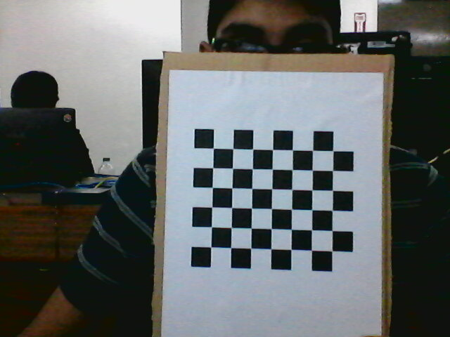
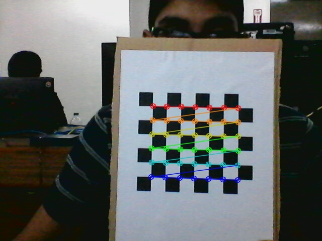
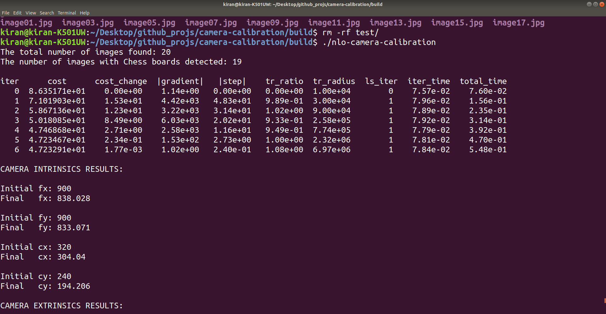

# Ceres & OpenCV bundle adjustment solution

This project presents a Ceres based solution for estimating a camera's intrinsics. The equations and theory used in code is heavily based on [OpenCV: Camera Calibration and 3D Reconstruction](https://docs.opencv.org/2.4/modules/calib3d/doc/camera_calibration_and_3d_reconstruction.html).

The image on the left shows an example of a raw image used for estimating the camera intrinsics. The right shows the redrawn board points which was computed based on the optimized camera intrinsics.

  
  &nbsp;&nbsp;&nbsp;&nbsp;&nbsp;&nbsp;&nbsp;
  

The image below is a snippet of terminal output. The snippet shows that it took 7 iterations to converge at the final estimate for the camera intrinsics.

    

# Running the code

This project requires specific legacy dependencies.

- OS: Ubuntu 18.04
- CERES: 2.1.0
- OpenCV: 3.2.0

Choose between the [Docker Build](#docker-build) (recommended) or  [Native Build](#native-build) section to compile and run the project. Available command-line options are detailed under [Executable Flags](#executable-flags) section.

## Docker Build 

The Docker image automatically provides the required OS, CERES, and OpenCV environments.

1. Build the Docker image from root: `docker build -t camera-calibration .`
2. Run the interactive container: `docker run --rm -it -v $(pwd):/workspace camera-calibration`
3. Build and compile inside the container: `cd build && cmake .. && make -j$(nproc)`
4. Execute the binary: `./nlo-camera-calibration`

## Native Build

1. Install the [Ceres](https://ceres-solver.readthedocs.io/latest/installation.html#installation) and [OpenCV](https://docs.opencv.org/4.x/d7/d9f/tutorial_linux_install.html) libraries globally.
   - *Note: `CMakeLists.txt` is configured for a global installation. If using a local installation, specify the `PATH` variable directly in `CMakeLists.txt`.*
2. Build and compile: `cd build && cmake .. && make -j$(nproc)`
3. Execute the binary: `./nlo-camera-calibration`

## Executable Flags

The executable uses gflags. 

- Documentation can be found using the command: `./build/nlo-camera-calibration --help`
- In summary, the gflags parameters which can be changed are:
  - Initial estimates
  - Calibration board parameters
  - Read/Write disk options
- gflag defaults are set to use the provided sample images to demonstrate out-of-the-box functionality.
- gflag example:
  - Write processed images to a specified directory "test": `./build/nlo-camera-calibration -write_directory=test/`